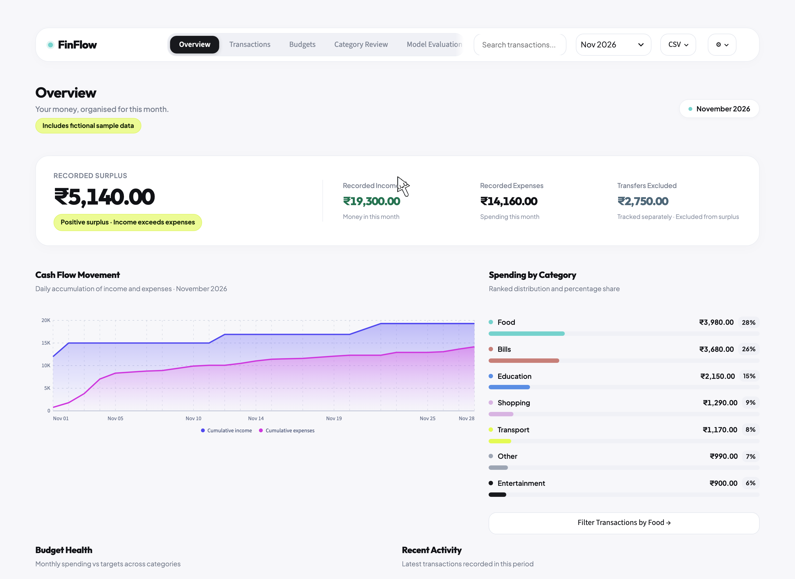

# FinFlow

FinFlow is an AI-assisted personal finance dashboard for students. It helps you see where your money went, check how spending compares with category budgets, and review expense categories suggested by a machine learning model. Built for the **AI for Finance CIA-2** assignment.

[Open the live demo](https://finflow-eight-henna.vercel.app/) · [Project report](docs/PROJECT_REPORT.md) · [Presentation walkthrough](docs/DEMO_SCRIPT.md)



## Try the demo

The hosted app opens on November 2026 with **218 fictional transactions across 12 months**. Each browser session gets its own temporary ledger. Use fictional data in the hosted demo.

- **Overview** compares monthly income and expenses, shows where spending went, and opens past months when you select a bar. Try March 2026 to see a month with a deficit.
- **Transactions** lets you search, filter, add transactions, and import or export a CSV. Internal transfers are tracked separately from income, expenses, and surplus.
- **Budgets** shows the target, spending, and remaining balance for each category. In November, Bills is ₹180 over target and Food has ₹220 left.
- **Category Review** opens with two fictional expenses flagged for review. Confirm or correct a category to update the ledger.
- **Model Evaluation** shows the held-out results and lets you inspect individual model decisions.

The November demo records **₹19,300 in income**, **₹14,160 in expenses**, and **₹5,140 in surplus**, with **₹2,750 in excluded transfers**. See the [sample CSV](data/demo/transactions.csv) and [expected monthly totals](data/demo/EXPECTED_TOTALS.json).

## How the AI works

When an expense has no category, FinFlow uses **TF-IDF** to represent the transaction description and **logistic regression** to suggest a category. If the description contains no known terms or the model score is below its cutoff, the app sends the expense to Category Review. Manual corrections remain on the transaction when the same CSV is imported again.

On 18 synthetic test examples, the model **categorized 5 correctly** and **sent 13 to human review**. These results describe a small fictional test set. Budget comparisons and financial totals use explicit rules and integer paise. The model runs without an external AI API. [Evaluation results](reports/model_evaluation.json)

## Run locally

Use Python 3.12. From the repository root in PowerShell:

```powershell
py -3.12 -m venv .venv
.\.venv\Scripts\python.exe -m pip install -r requirements-lock.txt
.\.venv\Scripts\python.exe -m streamlit run app.py --server.address 127.0.0.1
```

Open [localhost:8501](http://127.0.0.1:8501) and select **Try sample data**. The local app stores transactions and budgets in SQLite at `storage/finance.db`. To run the tests or reproduce the evaluation:

```powershell
.\.venv\Scripts\python.exe -m pytest -q
.\.venv\Scripts\python.exe scripts/evaluate_model.py
```

## Repository layout

| Path | Purpose |
| --- | --- |
| [app.py](app.py) and [src/](src/) | Streamlit screens, charts, transaction validation, analytics, categorization, and SQLite storage |
| [data/](data/) | Fictional demo, training, and evaluation data |
| [scripts/](scripts/) and [reports/](reports/) | Model evaluation script and saved results |
| [tests/](tests/) | Tests for transactions, storage, analytics, categorization, and the UI |
| [docs/](docs/) | Project report, presentation notes, and live dashboard screenshots |
| [vercel.json](vercel.json) | Vercel production deployment configuration for the hosted showcase |

The interface draws inspiration from the [Money Management Dashboard by Atiqur Rahman for ILmix Studio](https://dribbble.com/shots/27090441-Money-Management-Dashboard). Antigravity helped scaffold the project. Codex assisted with the dashboard, demo data, deployment, and verification.
